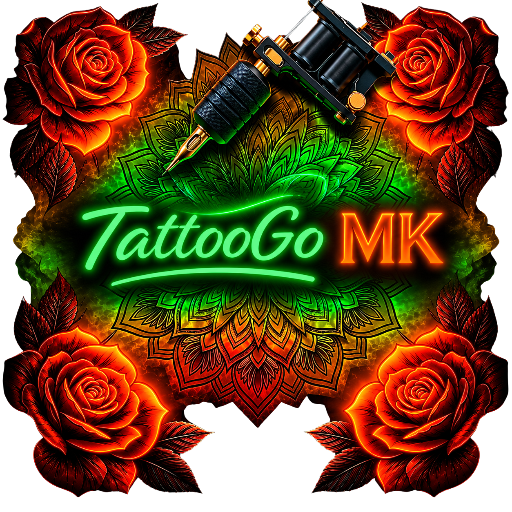
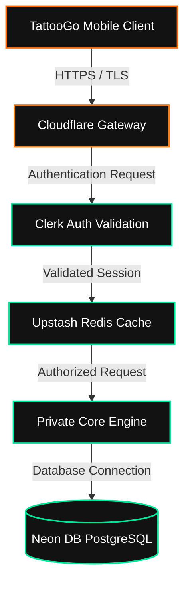

  

  <table align="center" style="border: none; background: transparent;">
    <tr>
      <td align="center" style="border: none; background: transparent; vertical-align: middle; padding-right: 15px;">
        
      </td>
      <td align="left" style="border: none; background: transparent; vertical-align: middle;">
         
         
         
        
      </td>
    </tr>
  </table>

   

  <table align="center">
    <tr>
      <td align="center" style="background-color:#111111; border:1px solid #FF6600; border-radius:14px; padding:10px 18px;">
        
      </td>
      <td width="18" style="border:none; background:transparent;"></td>
      <td align="center" style="background-color:#111111; border:1px solid #FF6600; border-radius:14px; padding:10px 18px;">
        
      </td>
    </tr>
  </table>
  
Private Beta / Q4 Release

<!-- Badges Tech Stack Mobile Oficiais -->

  
  
  
  
  
   
  
  
  
  
  

---

## TattooGo MK Mobile • Native Ecosystem & Experience

O **TattooGo MK Mobile** é a aplicação cliente e profissional desenvolvida em **React Native / Expo** para o ecossistema TattooGo MK. Projetada para entregar performance nativa, micro-interações fluidas e segurança de nível enterprise, a aplicação conecta entusiastas, artistas e estúdios em uma plataforma de descoberta visual e agendamento inteligente.

---

## Arquitetura Híbrida & Governança de Segurança

> **Nota de Engenharia:** Este repositório é público e dedicado exclusivamente à auditoria e apresentação da **camada de interface mobile (Front-End / UI-UX Nativa)**. O motor transacional, regras de negócio críticas, chaves de idempotência e o backend transacional operam sob blindagem restrita em repositórios privados (*Private Core*).

---

## Topologia de Infraestrutura & Fluxo

---

## Modulos & Experiencia Mobile

* **Acesso Freemium & Descoberta Visual:** Navegação aberta no feed público de inspirações e destaques para visitantes, com barreira inteligente que direciona para autenticação segura em interações avançadas e perfis completos.
* **Flash Notes Interativos:** Stories efêmeros com gatilhos dinâmicos de orçamento rápido e suporte a ofertas por tempo limitado.
* **Chat Especializado & Travas Operacionais:** Canais dedicados ao alinhamento de projetos entre cliente e artista, protegidos por travas de tempo e moderação automatizada para conversão segura.
* **Agendamento Inteligente & Gestão de Agenda:** Sincronização em tempo real de horários confirmados após validação de pagamento e notificações programadas para experiência sem atritos.

---

## Compliance, Privacidade & Termos de Uso (Portal Legal)

O ecossistema TattooGo MK opera em estrita conformidade com a LGPD (Lei nº 13.709/2018) e padrões internacionais de proteção de dados.

<b>Toque para abrir os Termos de Uso e Política de Privacidade (14 Cláusulas)</b>

<b>1. Aceitação, Natureza e Objeto</b>

Os presentes Termos regulam o uso do ecossistema TattooGo MK. A plataforma atua exclusivamente como intermediadora tecnológica entre clientes, artistas e estúdios independentes, não sendo parte executora do serviço físico de tatuagem.

<b>2. Elegibilidade e Idade Mínima</b>

Proibido o cadastro e uso autenticado para menores de 14 anos. Usuários entre 15 e 17 anos exigem consentimento e supervisão expressa do responsável legal, em conformidade com o Estatuto da Criança e do Adolescente (ECA).

<b>3. Modelo Freemium</b>

Visitantes podem navegar livremente pelo feed público, galeria e destaques. Interações sociais avançadas, visualização completa de perfis, chat, orçamentos e agendamentos exigem cadastro e autenticação de usuário.

<b>4. Governança e Padrões Elite</b>

Artistas e estúdios devem manter regularidade documental, profissional e sanitária. É estritamente vedada a negociação de serviços ou orçamentos fora da plataforma.

<b>5. Chat e Travas Operacionais</b>

Canais dedicados ao alinhamento técnico e formalização de orçamentos, protegidos por travas de tempo, validade de propostas e moderação automatizada contra fraudes ou desvio de transações.

<b>6. Agendamento e Pagamentos</b>

Confirmação de horários vinculada à retenção de sinal/calção e processamento seguro via gateway integrado com chaves de idempotência para evitar cobranças duplicadas.

<b>7. Cancelamento e Reagendamento</b>

Políticas transparentes com antecedência recomendada de 3 dias e limites operacionais de cancelamentos para preservação da agenda dos profissionais.

<b>8. Conduta e Moderação por IA</b>

Monitoramento automatizado de mensagens para coibir assédio, fraude e links externos, operando sob rigoroso dever de sigilo e finalidade exclusiva de segurança.

<b>9. Verificação Sanitária e Documental</b>

Responsabilidade exclusiva dos profissionais quanto a alvarás, biossegurança, assepsia e execução física do procedimento de tatuagem.

<b>10. Proteção de Dados (LGPD/GDPR)</b>

Tratamento restrito de dados cadastrais, geolocalização aproximada/precisa e logs para operação do marketplace, sem comercialização de informações pessoais a terceiros.

<b>11. Propriedade Intelectual</b>

Artistas mantêm direitos patrimoniais sobre suas obras, concedendo licença não exclusiva de exibição técnica estrita no âmbito do ecossistema digital.

<b>12. Suspensão e Exclusão</b>

Contas podem ser desativadas a pedido do usuário (carência de 90 dias para exclusão definitiva) ou banidas imediatamente em caso de infração grave aos termos.

<b>13. Segurança de Conta</b>

Uso obrigatório de credenciais seguras, autenticação em duas etapas/OTP e salvaguardas rigorosas contra impersonação.

<b>14. Disposições Gerais</b>

Aplicam-se as leis da República Federativa do Brasil, elegendo o foro conforme a legislação de consumo aplicável.

> Status de Release (Q4/2026): Aplicação mobile em ciclo ativo de homologação de interface e refinamento de módulos nativos.

© 2026 Gafisx & TattooGo MK. Todos os direitos reservados. Propriedade Intelectual Protegida.

