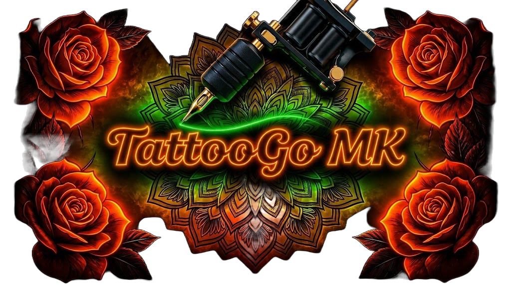

  

---

## ⚡ TattooGo MK • O Ecossistema da Arte na Pele

O **TattooGo MK** é uma aplicação corporativa de alto desempenho desenvolvida para conectar clientes, tatuadores independentes e estúdios de ponta em um único ecossistema digital integrado. Focado em experiência do usuário e design de excelência, o app gerencia portfólios imersivos e fluxos operacionais completos.

---

## 🛠️ Arquitetura & Core Tech Stack

Desenvolvido sob padrões modernos de engenharia de software e alta escalabilidade:

* **Frontend & Core:** Next.js (App Router), React, TypeScript, Tailwind CSS.
* **Persistência & Dados:** Neon DB (PostgreSQL), Prisma ORM.
* **Segurança & Infraestrutura:** Clerk Auth, Upstash Redis, Vercel Enterprise.

---

## 📱 Módulos & Experiência do Produto

* **Portfólios & Feeds Dinâmicos:** Exibição de trabalhos artísticos com suporte nativo a temas dinâmicos (Claro, Escuro e Padrão do Sistema).
* **Flash Notes:** Canal de interação rápida e dinâmicas em tempo real para artistas e estúdios.
* **Agendamento Inteligente:** Fluxos otimizados para gestão de horários e atendimento profissional.

---

## 🌐 Governança Corporativa

Este repositório contém a propriedade intelectual e o código-fonte proprietário do **TattooGo MK**, mantido sob as diretrizes de desenvolvimento da **Gafisx**.

---

  © 2026 Gafisx & TattooGo MK. Todos os direitos reservados.

